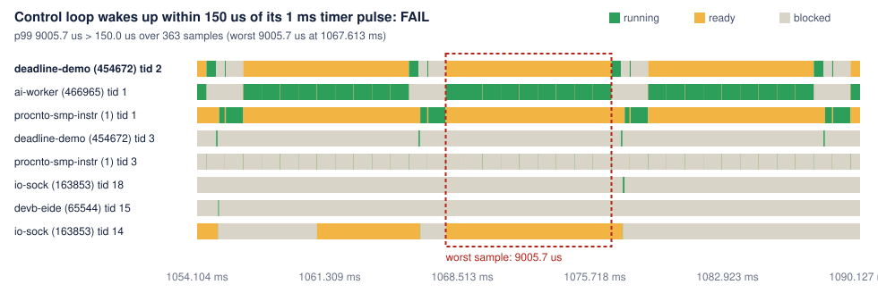

# Deadline CI

Real-time code fails quietly: a priority change or a new busy thread adds a few milliseconds of latency, nothing crashes, and the regression ships. QNX's System Profiler shows it beautifully, but only when someone opens it.

**Deadline CI turns QNX kernel traces into pass/fail tests.** Declare timing budgets for your threads, capture a trace with `tracelogger` during a scenario, and `deadline check` fails the build when a budget is missed, with JUnit output for any CI system, a Markdown summary for the job page and an SVG timeline of the worst violation.

```
$ deadline check trace.txt --budgets deadlines.toml --junit report.xml --svg worst.svg
FAIL  Control loop wakes up within 150 us of its timer pulse: p99 2300.0 us > 150.0 us over 59 samples (worst 2300.0 us at 40.000 ms)
```

Status: work in progress for the QNX Global Hackathon 2026 (category Developer Tooling & Host Tools). The checker, budget baseline and GitHub Action are tested in CI on real QNX OS 8.0 traces and synthetic ones, and the demo scenario below builds for and runs on QNX OS 8.0 (x86_64, QEMU) with SDP 8.0.

## Demo on QNX OS 8.0 (QEMU)

`scenario/` holds a small real-time system to test against, built with SDP 8.0's `qcc` for x86_64:

- `deadline-demo`: a 1 kHz control loop (thread 2, priority 30) blocked in `MsgReceivePulse()` until a periodic timer pulse arrives, plus a message server (thread 3, priority 20).
- `deadline-client`: sends a request with `MsgSend()` every 5 ms (thread 1, priority 25).
- `ai-worker`: a stand-in for a best-effort inference job that computes for part of every 10 ms.

`run-scenario.sh healthy` runs the worker below the control loop (priority 10, 30% duty); `run-scenario.sh regressed` makes the classic configuration mistake of running it above (priority 40, 90% duty). Each run captures 2 seconds of kernel events with `tracelogger` and decodes them with `traceprinter`. `scenario/deadlines.toml` holds the budgets.

```bash
# On a Linux x86_64 host with QNX SDP 8.0 (qcc, mkqnximage):
source ~/qnx800/qnxsdp-env.sh
target/build.sh ../qnx-image          # builds the programs and a QEMU image that runs both scenarios on boot

# Anywhere QEMU runs (this was developed on an Apple Silicon Mac):
target/run-qemu.sh ../qnx-image       # boots it, waits for the scenario, saves traces/healthy.txt and traces/regressed.txt
deadline check ../qnx-image/traces/healthy.txt   --budgets scenario/deadlines.toml   # passes
deadline check ../qnx-image/traces/regressed.txt --budgets scenario/deadlines.toml   # fails, with the worst violation drawn
```

The image prints each decoded trace on the serial console between markers, so no networking is needed. QEMU runs with `-icount shift=0,sleep=off`, which drives the guest's timers and cycle counter from one virtual clock: runs are deterministic and free of host noise, and the numbers are emulated time rather than wall-clock time. Without it, plain emulation lets the two clocks drift apart; the jitter budget flagged a 1 ms timer showing up as 1.3 and 2.6 ms intervals, which is exactly the kind of timing surprise Deadline CI is meant to catch.

Results from the traces in `examples/qnx-qemu/` (measurements of the demo programs under emulation, not QNX benchmarks):

| Run | Wake-up latency, p99 | Round trip, p99.9 | Period jitter, p99 | Worker CPU, max | Result |
|---|---|---|---|---|---|
| healthy | 1.6 us | 86.7 us | 2.5 us | 26.2% | all 4 budgets pass, exit 0 |
| regressed | 9,005.7 us | 86.7 us | 9,004.9 us | 81.7% | 3 budgets fail, exit 1 |

In the healthy run the loop wakes 2,001 times in 2 seconds, every period exactly 1,000 us. In the regressed run the worker, now above the loop, keeps it waiting about 9 ms at a time. The timeline of the worst violation shows the control loop ready (orange) but not running while the worker (green) holds the CPU:



You can check these traces on any machine, no QNX needed:

```bash
pip install .
deadline check examples/qnx-qemu/regressed.txt.gz --budgets scenario/deadlines.toml --svg worst.svg
```

This repository's CI runs the GitHub Action on both real traces and on synthetic ones, and fails if a regression is not caught.

**Licensing note.** QNX SDP's non-commercial licence covers a developer's own machines and virtual development environments, not build servers or cloud runners, so this repository's CI only checks trace files (two real ones captured on a developer machine, plus synthetic ones) and contains no QNX binaries. To run Deadline CI on real traces in CI, use a runner on a machine your QNX licence covers.

## Budgets

| Type | Measures | Typical use |
|---|---|---|
| `latency` | From a thread leaving a blocked state (for example RECEIVE, woken by a timer pulse) to running | Control loop wake-up latency |
| `roundtrip` | From a kernel call (for example `MSG_SENDV`) to its return, per thread | Client/server message round trip |
| `jitter` | How far the time between a thread's wake-ups strays from its period | 1 kHz loop period stability |
| `cpu` | Share of one CPU a process uses in each window | Keep a best-effort AI worker in its lane |

Each budget passes when its percentile (default 99; 100 is the maximum) is within the limit. See [`examples/deadlines.toml`](examples/deadlines.toml).

## Setting limits from a healthy run

Guessing microsecond budgets is hard, so measure them. Capture a trace of a run you know is good and let `deadline baseline` propose limits with headroom (25% by default), rounded to readable numbers. It edits the budgets file in place, keeping your comments:

```
$ deadline baseline good-run.txt --budgets deadlines.toml --write deadlines.toml
Control loop wakes up within 150 us of its timer pulse: p99 68.0 us over 500 samples -> max_us = 85 (now 150)
Control loop period stays within 200 us of 1 ms: max 48.0 us over 499 samples -> tolerance_us = 60 (now 200)
Wrote deadlines.toml with a 25% margin over this run.
```

## GitHub Action

```yaml
- name: Timing budgets
  uses: vinit1009/deadline-ci@v0
  with:
    trace: out/trace.txt          # traceprinter output from your scenario run
    budgets: deadlines.toml
```

The step fails when a budget is missed, writes `deadline-report.xml` (JUnit) and `deadline-worst.svg`, adds a Markdown summary to the job page, and sets the output `passed`. This repository's own CI runs the action on a healthy and a regressed demo trace and checks that the regression is caught (`.github/workflows/ci.yml`).

## Capturing a trace

On the QNX target (the instrumented kernel is standard in QNX SDP 8.0):

```sh
tracelogger -n 0 -s 2 -f /tmp/trace.kev &   # 2 seconds of events
./run-scenario
traceprinter -n -p "c:0x%016c CPU:%02C %-16Z:%-18z" -f /tmp/trace.kev > trace.txt
```

The custom format keeps the full 64-bit cycle count; the default format works too (32-bit wraps are undone with the kernel's CONTROL TIME events). Kernel calls are attributed to the thread running on that CPU.

## Running the tests

```sh
PYTHONPATH=.:tests python3 -m unittest discover -s tests
```

No dependencies beyond Python 3.11+.

## License

[MIT](LICENSE)
