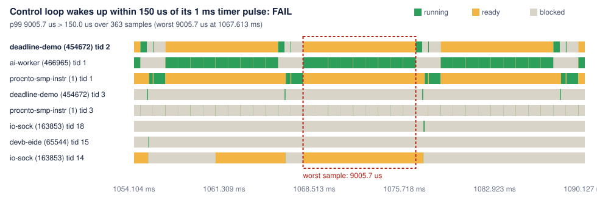

# Codelab: trace a QNX OS 8.0 program in QEMU and turn its timing into a CI test

You will build a small real-time system on QNX OS 8.0, boot it in QEMU, record its kernel events, and turn them into tests that fail when a change makes a real-time thread late. The system is a 1 kHz control loop woken by timer pulses, a message server with a client, and a CPU-heavy "AI worker". You will also learn to read the trace to see why a wake-up was late: interrupt handling, the kernel's timer and pulse delivery, or scheduling.

It was written on an Apple Silicon Mac, which QNX SDP 8.0 does not support as a host, so it also shows how to run the SDP's Linux x86_64 tools there. On a Linux x86_64 machine, skip step 1.

**What you'll learn**

- Install QNX SDP 8.0 from the command line, without the Software Center GUI.
- The classic QNX loop: a timer that delivers a pulse, `MsgReceivePulse()`, and `SCHED_FIFO` priorities.
- Add your own programs to a QEMU image with `mkqnximage` snippets, and run them at boot.
- Record and decode kernel events with `tracelogger` and `traceprinter` on the target, and get them out over the serial console.
- Make emulated timing repeatable with QEMU's instruction counting.
- Read thread states and the interrupt -> timer -> pulse -> ready -> running chain in a trace.
- Turn that timing into budgets that pass or fail, locally, on pull requests and in GitHub Actions.

**What you need**

- A myQNX account and the free QNX SDP 8.0 non-commercial licence: https://www.qnx.com/products/everywhere/
- A Linux x86_64 machine, or an Apple Silicon Mac with [Homebrew](https://brew.sh).
- Python 3.11 or newer, git, and about 6 GB of disk for SDP 8.0, its package cache and the image. That is what the Linux environment used at the end of this codelab.

**Tested with**: QNX SDP 8.0 (baseline `com.qnx.qnx800`, `qcc` 12.2.0), QEMU 11.1.3, colima 0.10.3 and Docker 29.8 on macOS 26.6 (Apple Silicon), an Ubuntu 24.04 container, Python 3.13, and Deadline CI 0.3.0.

| Step | What you do |
|---|---|
| [0](#0-see-the-end-result-first-no-qnx-needed) | See the end result on two recorded traces (5 minutes, no QNX needed) |
| [1](#1-a-linux-x86_64-environment-on-apple-silicon) | Get a Linux x86_64 environment on Apple Silicon |
| [2](#2-install-sdp-80-without-the-gui) | Install SDP 8.0 |
| [3](#3-a-real-time-program-to-measure) | Build the real-time programs with `qcc` |
| [4](#4-a-bootable-image-that-traces-at-boot) | Build a QEMU image that runs them and traces at boot |
| [5](#5-boot-with-repeatable-timing-and-collect-the-traces) | Boot it with repeatable timing and collect two traces |
| [6](#6-read-the-trace) | Read the trace by hand |
| [7](#7-turn-the-timing-into-tests) | Turn the timing into tests |
| [8](#8-where-did-the-time-go) | Find where the time went |
| [9](#9-compare-two-runs-and-check-in-ci) | Compare two runs and check them in CI |

## 0. See the end result first (no QNX needed)

The repository includes the two traces this codelab produces: a healthy run, and a run where one priority was changed. Install the checker and run it on both:

```bash
git clone https://github.com/vinit1009/deadline-ci && cd deadline-ci
python3 -m venv .venv && . .venv/bin/activate && pip install .
deadline check examples/qnx-qemu/healthy.txt.gz   --budgets scenario/deadlines.toml   # exit 0
deadline check examples/qnx-qemu/regressed.txt.gz --budgets scenario/deadlines.toml   # exit 1
```

**Checkpoint.** The healthy run passes every budget. The regressed run, where the AI worker was moved above the control loop's priority, prints:

```
FAIL  Control loop wakes up within 150 us of its 1 ms timer pulse: p99 9005.7 us > 150.0 us over 363 samples (worst 9005.7 us at 1067.613 ms)
FAIL  Clock interrupt to control loop running within 200 us: p99 9010.6 us > 200.0 us over 363 samples (worst 9010.6 us at 1067.608 ms); worst sample: interrupt -> timer fired 3.5 us, timer fired -> pulse sent 0.9 us, pulse sent -> ready 0.5 us, ready -> running 9005.7 us
PASS  Client request round trip under 400 us: p99.9 86.7 us <= 400.0 us over 182 samples (worst 86.7 us at 791.134 ms)
FAIL  Control loop period stays within 200 us of 1 ms: p99 9004.9 us > 200.0 us over 362 samples (worst 9005.0 us at 846.613 ms)
FAIL  AI worker uses at most 40% of the CPU: max 81.7% > 40.0% over 20 samples (worst 81.7% at 1300.000 ms)
```

The rest of this codelab produces those traces yourself, on QNX OS 8.0, and explains each number.

## 1. A Linux x86_64 environment on Apple Silicon

QNX SDP 8.0's host tools are Linux x86_64 (or Windows) binaries. On Apple Silicon, [colima](https://github.com/abiosoft/colima) starts a Linux VM with Apple's Rosetta translation, and Docker containers for `linux/amd64` then run the SDP tools at close to native speed. Run this in the folder that contains your `deadline-ci` clone from step 0 (`cd ..` from the clone; clone it there first if you skipped step 0). The container sees that folder as `/work`:

```bash
brew install colima docker qemu
colima start --profile qnx --arch aarch64 --vm-type vz --vz-rosetta --cpu 6 --memory 12 --disk 80
docker --context colima-qnx volume create qnx-home
docker --context colima-qnx run -d --name qnxhost --platform linux/amd64 \
  -v qnx-home:/root -v "$PWD":/work ubuntu:24.04 sleep infinity
docker --context colima-qnx exec qnxhost bash -lc 'apt-get update && apt-get install -y python3 file'
```

**Checkpoint.** `docker --context colima-qnx exec qnxhost uname -m` prints `x86_64`, and `docker --context colima-qnx exec qnxhost ls /work` lists `deadline-ci`.

Run steps 2 to 4 inside the container (`docker --context colima-qnx exec -it qnxhost bash`). QEMU itself runs on the Mac (step 5). The VM's disk is sparse: `--disk 80` is a limit, and the disk takes only the space actually used.

Licence note: the non-commercial single-user licence covers your own development machines, including virtual development environments, but not build servers or cloud machines. Keep SDP on your own machine and let CI work on the trace files (step 9).

## 2. Install SDP 8.0 without the GUI

First, in the myQNX **License Manager**, accept the SDP 8.0 licence and deploy it to your own account. Then download the QNX Software Center installer for Linux hosts from the myQNX download area (a self-extracting `.run` file), and in the container:

```bash
sh qnx-setup-*-linux.run --nox11 -- force-override disable-auto-start agree-to-license-terms ~/qnx/qnxsoftwarecenter
cd ~/qnx/qnxsoftwarecenter/qnxsoftwarecenter
read -rp "myQNX email: " QNX_USER; read -rsp "myQNX password: " QNX_PW; echo
QSC="./qnxsoftwarecenter_clt -myqnx.user $QNX_USER -myqnx.password $QNX_PW"
$QSC -addLicenseKey XXXX-XXXX-XXXX-XXXX-XXXX     # the key from the License Manager
$QSC -mirror                                     # without this, the baseline install misses packages
$QSC -installBaseline com.qnx.qnx800 -destination ~/qnx800
source ~/qnx800/qnxsdp-env.sh                    # puts qcc, mkqnximage and traceprinter on PATH
```

**Checkpoint.** `qcc -V` lists the compilers, with x86_64 as the default:

```
cc: targets available in /root/qnx800/host/linux/x86_64/etc/qcc:
	12.2.0,gcc_ntox86_64	(default)
	12.2.0,gcc_ntoaarch64le
	...
```

Three things to know:

- The key only works once the licence is deployed to your account in the License Manager.
- Installing the baseline right after a partial metadata sync fails with "requires 'package; com.qnx.qnx800.target' but it could not be found". `-mirror` fixes it.
- You do not need the optional QEMU quickstart package (`com.qnx.qnx800.quickstart.qemu`). Its prebuilt image unpacks to a 48 GB disk file; this codelab builds a small image of its own.

## 3. A real-time program to measure

The demo's control loop is the classic QNX pattern. A thread blocks in `MsgReceivePulse()` on a private channel until a periodic timer delivers a pulse, does its work, and blocks again (from `scenario/deadline-demo.c`):

```c
int const chid = ChannelCreate(_NTO_CHF_PRIVATE);
int const coid = ConnectAttach(0, 0, chid, _NTO_SIDE_CHANNEL, 0);
struct sigevent ev;
SIGEV_PULSE_INIT(&ev, coid, LOOP_PRIORITY, PULSE_CODE_TICK, 0);   /* the timer's event is a pulse */
timer_t timer;
timer_create(CLOCK_MONOTONIC, &ev, &timer);
struct itimerspec const period = { .it_value = { 0, 1000000 }, .it_interval = { 0, 1000000 } };
timer_settime(timer, 0, &period, NULL);                            /* every 1 ms */
for (;;) {
    struct _pulse pulse;
    if (MsgReceivePulse(chid, &pulse, sizeof pulse, NULL) == 0 && pulse.code == PULSE_CODE_TICK)
        spin_us(50);                                               /* the control work */
}
```

The pulse carries a priority (`LOOP_PRIORITY`). Pulses waiting on a channel are queued in priority order, and receiving one can change the receiving thread's effective priority (see "Priority inheritance and messages" in the QNX OS System Architecture guide). All threads use `SCHED_FIFO` at fixed priorities:

| Thread | Priority | What it does |
|---|---|---|
| `deadline-demo` tid 2, the control loop | 30 | the loop above |
| `deadline-demo` tid 3, a message server | 20 | `name_attach()`, `MsgReceive()`, about 80 us of work, `MsgReply()` |
| `deadline-client` | 25 | `name_open()`, then a `MsgSend()` request to the server every 5 ms |
| `ai-worker` | 10 (healthy) or 40 (regressed) | computes for part of every 10 ms (`-p priority -d duty%`) |

The loop's wake-up latency is the time from leaving the RECEIVE-blocked state to running. Raise the worker above the loop's priority 30 and the loop sits ready while the worker computes. That is the regression the tests should catch.

Build the three programs for x86_64 with `qcc`, and the image too (step 4), from the container:

```bash
source ~/qnx800/qnxsdp-env.sh      # in every new shell
cd /work/deadline-ci
target/build.sh /work/qnx-image
```

Or just the programs, by hand:

```bash
mkdir -p scenario/build/x86_64
for p in deadline-demo deadline-client ai-worker; do
  qcc -Vgcc_ntox86_64 -O2 -Wall -Wextra -o scenario/build/x86_64/$p scenario/$p.c
done
```

**Checkpoint.** `file scenario/build/x86_64/deadline-demo` reports a QNX binary:

```
ELF 64-bit LSB pie executable, x86-64, version 1 (SYSV), dynamically linked, interpreter /usr/lib/ldqnx-64.so.2, ...
```

## 4. A bootable image that traces at boot

`mkqnximage` builds a QEMU image from options plus "snippets" in a `local/snippets` folder of the directory you run it in. Two snippets are enough. `target/build.sh` copies them from `scenario/image/local/snippets/` and points the paths at your checkout.

`system_files.custom` adds the tracing tools and the demo to the system partition (`/system`):

```
bin/tracelogger=usr/sbin/tracelogger
bin/traceprinter=usr/bin/traceprinter
[perms=755] deadline/deadline-demo=/work/deadline-ci/scenario/build/x86_64/deadline-demo
[perms=755] deadline/deadline-client=/work/deadline-ci/scenario/build/x86_64/deadline-client
[perms=755] deadline/ai-worker=/work/deadline-ci/scenario/build/x86_64/ai-worker
[perms=755] deadline/run-scenario.sh=/work/deadline-ci/scenario/run-scenario.sh
[perms=755] deadline/autorun.sh=/work/deadline-ci/scenario/autorun.sh
```

`post_start.custom` runs a script once the system is up:

```
/system/deadline/autorun.sh &
```

`autorun.sh` runs the scenario twice, healthy and then regressed, and prints each decoded trace between markers on the console:

```sh
for mode in healthy regressed; do
  /system/deadline/run-scenario.sh $mode > /tmp/run-$mode.log 2>&1
  echo "===DEADLINE-TRACE-BEGIN $mode==="; cat /tmp/trace-$mode.txt; echo "===DEADLINE-TRACE-END $mode==="
done
echo "===DEADLINE-DONE==="
```

`run-scenario.sh` starts the three programs, captures two seconds of kernel events, and decodes them on the target. The only difference between the two runs is the worker's priority and duty cycle:

```sh
case "$1" in
  healthy)   WORKER="-p 10 -d 30" ;;
  regressed) WORKER="-p 40 -d 90" ;;
esac
./deadline-demo & sleep 1
./deadline-client &
./ai-worker $WORKER & sleep 1
tracelogger -n 0 -s 2 -f /tmp/trace-$1.kev
slay -f deadline-demo deadline-client ai-worker
traceprinter -n -p "c:0x%016c CPU:%02C %-16Z:%-18z" -f /tmp/trace-$1.kev > /tmp/trace-$1.txt
```

`-s 2` makes `tracelogger` log for two seconds. `-n 0` lifts its default limit of 32 buffers of about 16 KB each, roughly 32,000 of these 16-byte events, which would end this trace early: the healthy run records about 40,000. The `-p` format prints the full 64-bit cycle count on every event, so there are no counter wraps to undo later. The image itself (`target/build.sh` runs this in the image directory):

```bash
mkqnximage --type=qemu --arch=x86_64 --cpu=1 --ram=1G --hostname=deadline-demo --noprompt --force --build
```

The default kernel, `procnto-smp-instr`, is the instrumented one tracing needs. Why x86_64 on an ARM Mac: the aarch64 QEMU "virt" start-up code is not in SDP 8.0's base packages, while the x86_64 start-up is.

**Checkpoint.** `ls /work/qnx-image/output` shows `ifs.bin` (about 11 MB, the boot image) and `disk-qemu.vmdk` (a small descriptor for the 155 MB `disk-qemu` beside it).

## 5. Boot with repeatable timing and collect the traces

Back on the Mac (or your Linux host), from your clone:

```bash
target/run-qemu.sh ../qnx-image traces
```

It boots the image in QEMU, waits for `===DEADLINE-DONE===` on the serial console, stops QEMU, and cuts the two traces out of the log into `traces/` (ignored by git). By hand, that is:

```bash
mkdir -p traces
qemu-system-x86_64 -display none -monitor none -serial file:traces/serial.log \
  -m 1G -smp 1 -cpu max -icount shift=0,sleep=off \
  -drive file=../qnx-image/output/disk-qemu.vmdk,if=ide -kernel ../qnx-image/output/ifs.bin &
until grep -q '===DEADLINE-DONE===' traces/serial.log 2>/dev/null; do sleep 2; done; kill %1
for mode in healthy regressed; do
  awk "/===DEADLINE-TRACE-BEGIN $mode===/{f=1;next}/===DEADLINE-TRACE-END $mode===/{f=0}f" traces/serial.log | tr -d '\r' > traces/$mode.txt
done
```

**Checkpoint.** `run-qemu.sh` prints `traces/healthy.txt` and `traces/regressed.txt` with their line counts, roughly 40,000 and 32,000, and suggests the next command.

`-icount shift=0,sleep=off` is the important flag. Without it, x86_64 emulated on ARM lets the guest's timer interrupts and its cycle counter drift apart: a 1 ms periodic timer showed up as a mix of 1.3 and 2.6 ms intervals. With instruction counting, both come from one virtual clock. The clock interrupt arrives every 1,000 us to within 0.2 us, and two boots of the same image agree to within half a microsecond at p99. The numbers are emulated time, which suits regression tests: what changes from one run to the next is mostly what you changed.

No networking is needed: the traces travel over the serial console.

## 6. Read the trace

Install the checker on the host if you skipped step 0 (`pip install git+https://github.com/vinit1009/deadline-ci`), then list the processes and threads:

```bash
deadline threads traces/healthy.txt
```

```
       1  /proc/boot/procnto-smp-instr             tids 1, 2, 3, 4, 5, 6, 7, 8, 9, 10
   ...
  364560  ./deadline-demo                          tids 1, 2, 3
  376852  ./deadline-client                        tids 1
  376853  ./ai-worker                              tids 1
  393238  system/bin/tracelogger                   tids 1, 2, 3
```

Your pids will differ, so budgets select threads by process name and thread id. The file starts with a header; `TRACE_CYCLES_PER_SEC` converts cycle counts to time:

```
  TRACE_CYCLES_PER_SEC:: 999999900
         TRACE_CPU_NUM:: 1
```

Here is one tick of the control loop (pid 364560, tid 2) in the healthy trace, with the events of other threads left out:

```
c:0x00000007cce9ecd5 CPU:00 THREAD          :THRECEIVE          pid:364560 tid:2
c:0x00000007ccf84e47 CPU:00 INTERRUPT       :INT_DELIVER       intr_id:0x80010000(2147549184)
c:0x00000007ccf857f9 CPU:00 SYSTEM          :TIMER              pid:364560 tid:0 timer_id:0 flags:0x00000011 ACTIVE TARGET_PROCESS
c:0x00000007ccf85bc2 CPU:00 COMM            :SND_PULSE_EXE      scoid:0x00010001 pid:364560
c:0x00000007ccf85d91 CPU:00 THREAD          :THREADY            pid:364560 tid:2
c:0x00000007ccf863a9 CPU:00 THREAD          :THRUNNING          pid:364560 tid:2
c:0x00000007ccf865fc CPU:00 COMM            :REC_PULSE          scoid:0x00010001 pid:364560
```

Read it top to bottom. The loop blocks in `MsgReceivePulse()` (THRECEIVE). The clock interrupt arrives (INT_DELIVER), the kernel fires the loop's timer (SYSTEM:TIMER) and sends its pulse (SND_PULSE_EXE). That makes the loop ready (THREADY), it runs (THRUNNING), and it receives the pulse (REC_PULSE).

Work out the wake-up latency by hand: THRUNNING minus THREADY is 0x63a9 - 0x5d91 = 0x618 = 1,560 cycles, which is 1.56 us at 999,999,900 cycles per second. From the interrupt to running is 0x63a9 - 0x4e47 = 5,474 cycles, about 5.5 us. `deadline` does the same arithmetic for every tick and reports percentiles.

## 7. Turn the timing into tests

Budgets live in a TOML file. Each one names a thread or process, a measurement, a percentile and a limit (`scenario/deadlines.toml` has all five):

```toml
[[budget]]
name = "Control loop wakes up within 150 us of its 1 ms timer pulse"
type = "latency"              # from leaving from_state to running
thread = { process = "deadline-demo", tid = 2 }
from_state = "THRECEIVE"      # blocked in MsgReceivePulse() until the timer pulse arrives
percentile = 99
max_us = 150

[[budget]]
name = "Client request round trip under 400 us"
type = "roundtrip"            # from a kernel call to its return
thread = { process = "deadline-client", tid = 1 }
call = "MSG_SENDV"            # MsgSend(), including the server's work
percentile = 99.9
max_us = 400
```

The other types are `jitter` (how far a periodic thread strays from its period), `cpu` (a process's share of a CPU per window) and `chain` (step 8). If a selector matches nothing, the budget fails with "No samples matched this budget; check its thread or process selector".

To choose limits, measure a run you know is good. `deadline baseline` proposes limits with 25% headroom (`--margin`), and `--write` saves them:

```bash
deadline baseline traces/healthy.txt --budgets scenario/deadlines.toml
```

```
Control loop wakes up within 150 us of its 1 ms timer pulse: p99 1.6 us over 2001 samples -> max_us = 2 (now 150)
Clock interrupt to control loop running within 200 us: p99 7.6 us over 2001 samples -> max_us = 9.5 (now 200)
Client request round trip under 400 us: p99.9 86.7 us over 334 samples -> max_us = 110 (now 400)
Control loop period stays within 200 us of 1 ms: p99 2.5 us over 2000 samples -> tolerance_us = 3.2 (now 200)
AI worker uses at most 40% of the CPU: max 26.2% over 20 samples -> max_share = 0.33 (now 0.4)
```

The demo keeps much wider limits than that: under emulation, generous headroom avoids failures from noise, and a real regression is far bigger. Now check both runs:

```bash
deadline check traces/healthy.txt   --budgets scenario/deadlines.toml                                   # exit 0
deadline check traces/regressed.txt --budgets scenario/deadlines.toml --svg worst.svg --junit report.xml   # exit 1
```

**Checkpoint.** The output matches step 0: the healthy run passes all five budgets, and the regressed run fails four and exits 1. Moving the AI worker above the loop's priority takes the loop's p99 wake-up latency from 1.6 us to about 9,000 us. `report.xml` is JUnit for any CI system. `worst.svg` draws every thread's running, ready and blocked states around the worst violation: the loop sits ready while the worker runs.



## 8. Where did the time go?

A late wake-up can come from interrupt handling, from the kernel's timer and pulse delivery, or from scheduling. Step 6 showed an event for each. A `chain` budget names those stages and measures from the first one to the thread running:

```toml
[[budget]]
name = "Clock interrupt to control loop running within 200 us"
type = "chain"
thread = { process = "deadline-demo", tid = 2 }
from_state = "THRECEIVE"
stages = ["INTERRUPT:INT_DELIVER intr_id=0x80010000", "SYSTEM:TIMER", "COMM:SND_PULSE_EXE"]
percentile = 99
max_us = 200
```

For each wake-up, the checker walks back from THREADY: to the latest pulse before it, the latest timer before that, and the latest clock interrupt before that, each within `window_us` (default 1,000 us) of the next. Wake-ups the chain did not cause, such as a message, are skipped. The `intr_id=` filter matters: another interrupt between the clock interrupt and the timer would otherwise be taken as the start of the chain.

On the regressed trace, the budget fails and splits the worst wake-up into stages: 3.5 us from the interrupt to the timer firing, 0.9 us to the pulse, 0.5 us to ready, and 9,005.7 us from ready to running. The kernel did its part in about 5 us, so the fix is the worker's priority, not the timer.

## 9. Compare two runs and check in CI

On a pull request, the useful question is what got worse. `deadline compare` judges the head run against a base run, budget by budget, and exits 1 on a budget that passed on the base but misses on the head. Add `--max-increase 0.25` to also fail on one that got more than 25% slower while still passing:

```bash
deadline compare traces/healthy.txt traces/regressed.txt --budgets scenario/deadlines.toml --summary pr.md
```

```
NEW MISS      Control loop wakes up within 150 us of its 1 ms timer pulse: 1.6 us -> 9,005.7 us, +9,004.1 us (x5,773), limit 150.0 us
NEW MISS      Clock interrupt to control loop running within 200 us: 7.6 us -> 9,010.6 us, +9,003.0 us (x1,187), limit 200.0 us; ready -> running +9,004.1 us at p99
OK            Client request round trip under 400 us: 86.7 us -> 86.7 us, no change, limit 400.0 us
NEW MISS      Control loop period stays within 200 us of 1 ms: 2.5 us -> 9,004.9 us, +9,002.4 us (x3,611), limit 200.0 us
NEW MISS      AI worker uses at most 40% of the CPU: 26.2% -> 81.7%, +55.4 pts (+211%), limit 40.0%
```

`pr.md` is the same as a Markdown table, ready for a review comment, and it ends with the chain stage that grew: "ready -> running +9,004.1 us at p99".

In GitHub Actions, the action checks a trace and, with `compare-to`, compares it with a reference run:

```yaml
- uses: vinit1009/deadline-ci@v0
  with:
    trace: traces/regressed.txt
    budgets: scenario/deadlines.toml
    compare-to: traces/healthy.txt   # optional: a reference run, for example from main
```

The step fails the build, writes JUnit results, and adds the results (and the comparison) to the job summary. SDP stays on your own machine, so capture traces there, or on a self-hosted runner on that machine, and let CI check the trace files.

## Troubleshooting

| Symptom | Cause | Fix |
|---|---|---|
| The licence key is refused | The licence is not deployed to your account yet | Accept and deploy it in the myQNX License Manager, then retry `-addLicenseKey` |
| `-installBaseline` fails with "requires 'package; com.qnx.qnx800.target' but it could not be found" | Partial package metadata | Run `-mirror`, then install again |
| A 1 ms timer shows up as 1.3 and 2.6 ms intervals | QEMU without instruction counting | Boot with `-icount shift=0,sleep=off` |
| `run-qemu.sh` says "the scenario did not finish" | Something failed on the target | Read `traces/serial.log`: it has the whole console, including errors from `autorun.sh` |
| "deadline-demo: cannot start threads (are you root?)" | Setting the `SCHED_FIFO` priorities failed | Run the demo as root, as the image's start-up script does |
| "No samples matched this budget" | The budget's thread selector does not match the trace | Compare it with `deadline threads <trace>` (process name and tid) |

## What you learned

You installed QNX SDP 8.0 from the command line and built QNX programs and a QEMU image on a Mac. You recorded kernel events at boot and read thread states and the interrupt -> timer -> pulse -> running chain straight from the trace. Then you turned that timing into tests that fail the build when a change makes a real-time thread late, and that say where the time went.

Next: write budgets for your own threads, take limits from a good run with `deadline baseline --write`, and add `compare-to` so every pull request is judged against main. On real hardware the same trace format applies, with real rather than emulated time. Measure your own baseline there before choosing limits.
